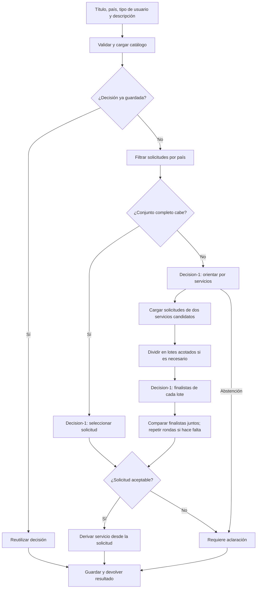

# MS clasificador de solicitudes Jira nuam

Microservicio en **Go, GORM y PostgreSQL** que recibe cuatro campos de un borrador, identifica una **solicitud** con Microsoft-Decision-1 y devuelve el **servicio asociado** en el catálogo. La solicitud se selecciona por código: los nombres iguales en servicios diferentes siguen siendo opciones distintas.



El consumidor entrega el resultado a un formulario común de Jira. Ese formulario pide aplicación, ambiente, datos operativos y adjuntos y crea el ticket. El MS no construye formularios, redirige usuarios, crea tickets ni resuelve variantes, perfiles de incidente o prioridades.

## Contrato HTTP

`POST /clasificaciones`, con `Content-Type: application/json` y `Authorization: Bearer <API_TOKEN>` cuando está configurado.

```json
{
  "titulo": "Necesito un ajuste de balance",
  "pais": "Chile",
  "tipo_usuario": "Colaborador",
  "descripcion": "Se requiere recargar el balance del inversionista por una inversión en firme."
}
```

Los cuatro campos son strings obligatorios y se recortan sus espacios extremos. Límites: título 1.000 caracteres, país 80, tipo de usuario 100 y descripción 20.000; cuerpo máximo de 128 KiB. No se exige un ticket existente. Campos desconocidos, null, vacíos y el contrato anterior con `ticket_id`, `resumen`, `tipo_ticket` o `contexto` devuelven 422. La entrada no admite `referencia`.

Respuesta de clasificación, **ilustrativa**: los códigos y la probabilidad siguientes no son IDs de Jira ni una medición real.

```json
{
  "decision_id": "...",
  "estado": "clasificado",
  "motivo": "solicitud_identificada",
  "solicitud": {"codigo": "SOL_EJEMPLO", "nombre": "Ajustes al Balance"},
  "servicio": {"codigo": "SER_EJEMPLO", "nombre": "Soporte Aplicaciones"},
  "probabilidad_solicitud": 0.94,
  "modo": "real",
  "proveedor": "microsoft-decision-1",
  "modelo": "microsoft-decision-1",
  "catalogo_version": "...",
  "catalogo_provisional": true,
  "jira_modificado": false,
  "candidatos": [],
  "politica": {"umbral": 0.9, "margen_minimo": 0.08},
  "latencia_ms": 100,
  "reutilizada": false
}
```

La respuesta efectiva incluye hasta cinco candidatos con `solicitud`, `servicio` y `probabilidad` (proveedor real) o `puntaje_simulado` (mock). En modo simulado, tampoco se devuelve `probabilidad_solicitud`: se usa `puntaje_simulado`. Esos puntajes son coincidencias de texto, no probabilidades ni evidencia del desempeño de Decision-1.

Cuando falta evidencia, la respuesta HTTP 200 usa `estado=requiere_aclaracion`, `solicitud=null`, `servicio=null` y candidatos disponibles. `motivo` distingue `baja_confianza`, `solicitud_ambigua`, `sin_correspondencia_en_catalogo`, `catalogo_sin_solicitudes`, `sin_solicitudes_para_pais` y `descripcion_catalogo_pendiente`. La abstención no asigna una solicitud ni un servicio.

Los errores técnicos son diferentes: 422 entrada inválida, 401 autenticación inválida, 413 cuerpo excesivo, 503 catálogo/base/proveedor no disponible o respuesta del modelo inválida, 504 timeout del proveedor. Los errores del proveedor no se persisten como decisiones correctas y no se convierten en aclaraciones.

## Clasificación y contexto

1. Validar los cuatro campos de entrada y cargar el catálogo versionado de requerimientos estándar.
2. Preparar opciones con servicio, nombre de solicitud, descripción, requisitos y países, filtradas por el país de entrada.
3. Si las opciones completas caben en el presupuesto JSON, resolver la solicitud directamente. Si no caben, usar una pregunta `choice` para orientar la búsqueda por servicio. Cada servicio se describe con los nombres de **todas** sus solicitudes elegibles, sin texto generado ni requisitos inventados.
4. Evaluar las solicitudes completas de los dos servicios candidatos mejor posicionados. El servicio de esta etapa es provisional: el servicio final siempre se deriva de la solicitud elegida.
5. Si un conjunto sigue siendo grande, dividirlo en lotes que respeten el presupuesto, sin truncar sus descripciones o requisitos. Cada lote propone hasta dos finalistas. Si retener dos impide reducir la siguiente ronda, propone uno. Repetir hasta poder comparar los finalistas juntos, incluyendo abstención.
6. Enviar los cuatro campos de entrada como `state` en cada llamada. Las probabilidades de lotes diferentes **no se comparan entre sí**. La probabilidad final de solicitud procede únicamente de la última comparación de solicitudes.
7. Validar códigos, distribución de probabilidades y selección. Aplicar umbral y margen respecto de la segunda opción. Las definiciones pendientes del catálogo se envían a aclaración.
8. Obtener el servicio desde el padre de la solicitud. El servicio no se infiere con otra llamada ni recibe una probabilidad inventada.

**País y tipo de usuario permanecen obligatorios en la entrada.** El país filtra las solicitudes con alcance conocido antes de llamar a la IA; tipo de usuario solo aporta contexto. Se conservan los valores originales de país de la columna P en una lista `countries`, sin perder valores al agrupar filas. `Regional` cubre Chile, Perú y Colombia; se admiten valores como `Chile/Perú` y `Chile - Colombia` y se comparan sin distinguir acentos o mayúsculas. Un alcance vacío o desconocido no excluye una solicitud. Si no quedan opciones, se devuelve `requiere_aclaracion` con `motivo=sin_solicitudes_para_pais`. No se importan aplicación, ambiente, solicitante, variantes ni perfiles de incidente.

Los umbrales iniciales `DECISION_THRESHOLD=0.90` y `DECISION_MIN_MARGIN=0.08` son configurables y requieren evaluación con casos representativos. No garantizan precisión. La clasificación final evaluada ahora es **solicitud + servicio**, no variante operativa.

## Proveedores

`DECISION_PROVIDER=mock` es el valor por defecto del entorno local. `PROVIDER_FAILURE=none|error|timeout` permite verificar contratos de falla sin consumir Azure. El timeout simulado no espera ni prueba la red.

Para usar el adaptador real, exportar estas variables antes de ejecutar `serve` (ver `.env.example`; no se carga automáticamente):

```bash
export DECISION_PROVIDER=decision-1
export PROVIDER_FAILURE=none
export AZURE_ENDPOINT='https://RECURSO.cognitiveservices.azure.com'
export DEPLOYMENT_NAME='NOMBRE_DEL_DESPLIEGUE'
# Configurar AZURE_API_KEY o AZURE_ENTRA_TOKEN mediante el gestor de secretos.
```

Se exige exactamente una credencial. El token Entra debe renovarse externamente; no hay adquisición/renovación automática. El adaptador llama a `/providers/microsoft/v1/systemone`, usa el nombre de despliegue en `model`, incluye descripciones en `criteria` y lee `answers.solicitud.choice` y sus probabilidades. Admite distribuciones como objeto o lista de `{value, probability}`. Rechaza opciones desconocidas, probabilidades faltantes/nulas/fuera de rango, distribuciones incompletas y selección incompatible con la distribución. No usa el campo `confidence` como sustituto de la probabilidad seleccionada.

Timeout por llamada de 15 segundos, con límite total de clasificación de 60 segundos y timeout de escritura HTTP de 65 segundos por defecto. `DECISION_TIMEOUT_SECONDS` y `CLASSIFICATION_TIMEOUT_SECONDS` son configurables. No se siguen redirecciones con credenciales ni se exponen cuerpos de error de Azure al consumidor. No hay fallback silencioso a mock ni reintentos automáticos. Proveedor desconocido o configuración real incompleta impiden arrancar.

Referencia del adaptador: [API Microsoft-Decision-1 en Microsoft Foundry](https://learn.microsoft.com/en-us/azure/foundry/foundry-models/how-to/use-foundry-models-microsoft-decision) y [formatos de probabilidades del ejemplo Microsoft](https://techcommunity.microsoft.com/blog/educatordeveloperblog/the-agentic-gatekeeper-using-microsoft-decision-1-to-decide-when-agents-act/4569246).

El adaptador tiene pruebas HTTP locales y pruebas explícitas contra el despliegue real `Decision-1`. El usuario autorizó el envío del catálogo aplicable a Chile a su recurso Azure. El intento anterior de enviar las 225 solicitudes juntas devolvía 422 por exceder 32.768 tokens; se conserva ese diagnóstico como antecedente.

La nueva estrategia jerárquica se probó el 18 de noviembre de 2026 con el catálogo interno: Crear Cuenta → Gestion de Usuarios (5 llamadas, ~3,00 s), Backup Base de Datos → Backup, Recuperacion y Disponibilidad de Datos (2 llamadas, ~0,79 s) y una petición ajena al catálogo → aclaración (1 llamada, ~0,31 s). Son casos construidos, no una medición de precisión operativa.

`DECISION_MAX_REQUEST_BYTES=24000` limita conservadoramente el JSON completo de cada llamada; es un límite en bytes, **no un contador exacto de tokens**. Valores permitidos: 4.096–28.000. No se envían opciones individuales que no quepan: se responde 413 con `entrada_o_opcion_supera_presupuesto_modelo`, sin truncar contenido. Si los finalistas completos no pueden compararse juntos tras reducirlos, también se devuelve ese error. Un rechazo de contexto de Azure se distingue como 503 `proveedor_limite_contexto`, no reintentable.

`DECISION_SERVICE_CANDIDATES=2` (1–4) controla los servicios provisionales que se exploran. Si la última comparación se abstiene o no supera los umbrales, el MS pide aclaración; no acepta el ganador de un lote basándose en su probabilidad local ni cambia silenciosamente a mock. La selección inicial de servicios y las rondas de finalistas pueden descartar la solicitud correcta: medir recuperación, precisión y cobertura con casos representativos antes de automatizar en producción.

La respuesta añade `estrategia` (`directa`, `jerarquica`, `lotes` o `simulada`) y `etapas` con fase, ronda, lote, cantidad de opciones, tamaño JSON, selección, probabilidad local y latencia. La última etapa de servicio registra los servicios candidatos. Estas probabilidades no se multiplican ni se presentan como confianza conjunta de la ruta.

## Entorno local

Requisitos: Docker, Go 1.25.4 o posterior, kubectl y ripgrep. El instalador incluido es para Linux amd64. El primer arranque necesita Internet para descargar imágenes y módulos fijados en `go.mod`/`go.sum`.

```bash
bash scripts/install-tools.sh
bash scripts/up.sh
```

Importa por defecto `../Catálogo de servicio TI 1.xlsx`; cambiar con `CATALOG_FILE`. Arranca k3d, PostgreSQL y la API Go, importa el Excel mediante Job temporal y conserva secretos/PVC existentes. API en imagen `scratch`, sin root y con filesystem de solo lectura. `Dockerfile` incluye certificados CA para HTTPS hacia Foundry.

- Swagger: <http://127.0.0.1:8000/docs>.
- Contrato: <http://127.0.0.1:8000/openapi.json>.
- Salud: `/health`; base y catálogo: `/ready`. Ambos informan el modo efectivo.
- Catálogo autenticado: `/catalogo/resumen`, `/catalogo/solicitudes`, `/catalogo/servicios`. Las rutas anteriores de familias, variantes y perfiles de incidente devuelven 404.
- Postman: importar `postman/collection.json` y `.runtime/postman.local.environment.json`. Este último contiene un token: no compartirlo.

El manifiesto base mantiene `mock`. Para Azure, configurar las credenciales externamente en el Secret `jira-decision-credentials` (`AZURE_ENDPOINT`, `DEPLOYMENT_NAME` y la credencial elegida). `up.sh` selecciona `decision-1` cuando existe ese Secret y conserva la integración en los siguientes arranques. Una variable explícita `DECISION_PROVIDER=mock` permite usar el simulador. No guardar claves en manifiestos; los archivos locales de credenciales quedan en `.runtime/`, ignorado por Git.

## Catálogo y persistencia

El catálogo contiene únicamente estos cinco datos de negocio por solicitud estándar:

| Dato | Origen en `Matriz Solicitudes Estándar` |
| --- | --- |
| Servicio | Columna A |
| Nombre de Solicitud | Columna B |
| Descripción de la Solicitud | Columna C |
| Requisitos | Columna J |
| País | Columna P |

El importador solo requiere y lee esa hoja. Ignora las demás hojas y columnas del Excel. Los códigos internos, referencias al servicio, versión de esquema y hash del archivo se conservan como metadatos técnicos.

El Excel inicial produce **383 solicitudes en 16 servicios**, desde 417 filas válidas. Las filas con el mismo servicio y nombre normalizados se agrupan; las descripciones y requisitos distintos se conservan concatenados, sin duplicar textos idénticos, y los países originales se conservan en una lista sin duplicados. Si dos filas difieren solo en datos omitidos, no producen variantes. Los requisitos agrupados son texto de referencia del catálogo; no constituyen una lista de campos obligatorios para todas las situaciones. Queda pendiente revisar esa agrupación con el responsable.

Hay once descripciones de filas pendientes y una fila inválida excluida. No se importan familias, aplicaciones, ambientes, solicitantes, incidentes, prioridades, SLA ni variantes. La fuente definitiva y los IDs de Jira siguen pendientes.

**El almacenamiento actual es PostgreSQL relacional con JSONB, no una BD vectorial.** No se crean embeddings ni un índice vectorial en este cambio. Cuando se incorpore recuperación vectorial, el contenido de cada documento deberá provenir de esos mismos cinco datos; requiere definir el modelo de embeddings y la recuperación. Se conserva todo el catálogo en PostgreSQL. El envío a Decision-1 se divide mediante servicios candidatos y lotes acotados, sin eliminar registros ni implementar recuperación vectorial.

El esquema `standard-requests-v3` identifica este catálogo reducido. La API solo carga snapshots de ese esquema; no usa como fallback el catálogo anterior con incidentes. **Reimportar mediante `bash scripts/up.sh`** al actualizar: si solo hay versiones antiguas, `/ready` devuelve 503 hasta importar. Se conservan los snapshots históricos y decisiones anteriores para evitar una eliminación destructiva; no participan en el catálogo activo.

PostgreSQL conserva versiones y decisiones sin guardar el texto de entrada en la tabla de decisiones. La clave de idempotencia incluye **los cuatro campos**, versión del catálogo, proveedor/configuración, umbrales y versión del contrato. Una repetición devuelve el mismo `decision_id` con `reutilizada=true`; cambiar cualquier entrada o configuración produce otra clave. Incrementar `DECISION_CONFIG_VERSION` al actualizar el modelo bajo un despliegue con el mismo nombre.

Las decisiones anteriores permanecen en la base, pero el nuevo espacio de claves no las reutiliza como resultados del contrato nuevo. No hay migración destructiva. Los códigos se derivan de servicio y nombre; no dependen de las columnas omitidas. Los datos persisten al detener/iniciar el clúster; el PVC no es un backup.

## Verificación

```bash
bash scripts/test.sh
bash scripts/build.sh
.runtime/bin/jira-poc generate-postman
bash scripts/evaluate.sh
```

Las pruebas verifican importación real de los cinco datos, agrupación sin pérdida de requisitos, independencia de columnas/hojas omitidas, contrato de cuatro campos, solicitud/servicio, contexto de país y tipo de usuario, ambigüedad, abstención, fallas técnicas, idempotencia y adaptador Foundry mediante HTTP de prueba. Si no hay compilador C local, `test.sh` ejecuta pruebas normales; para el detector de carreras se puede usar:

```bash
docker build --target test \
  --secret 'id=catalog,src=../Catálogo de servicio TI 1.xlsx' \
  -t jira-poc-nuam:test .
```

Verificación del 16 de noviembre de 2026: compilación, `go vet`, pruebas Go y detector de carreras dentro de Docker aprobados. Se verificó el adaptador con HTTPS de prueba; la validación inicial era contra HTTPS de prueba. El 18 de noviembre se añadió la prueba real con catálogo sintético descrita arriba.

La colección y `examples/manual_cases.json` son casos construidos para el simulador y pendientes de revisión humana. `evaluate` reporta cumplimiento de contrato y latencia, con `real_model_accuracy_measured=false`; no demuestra precisión del modelo. No usar sus expectativas de mock para evaluar el proveedor real.

```bash
.runtime/bin/jira-poc import-catalog --file '../Catálogo de servicio TI 1.xlsx' --dry-run
bash scripts/kubectl.sh -n jira-poc exec deployment/jira-api -- /jira-poc verify-database
bash scripts/stop.sh
```

`stop.sh` conserva el clúster y volúmenes. Para probar el cambio desplegado, ejecutar `up.sh` para reconstruir la imagen; editar el código no actualiza los pods existentes.

Para repetir únicamente la prueba real con datos sintéticos, exportar las variables de Foundry mediante el entorno seguro y ejecutar:

```bash
DECISION_LIVE_TEST=1 \
  GOCACHE="$PWD/.runtime/go-cache" GOMODCACHE="$PWD/.runtime/go-mod" \
  GOTOOLCHAIN=local go test ./internal/poc -run '^TestDecisionLiveSynthetic$' -count=1 -v
```

La prueba está deshabilitada por defecto, usa dos solicitudes inventadas en memoria y no lee ni envía el Excel. Requiere acceso de red a Azure y realiza dos inferencias pequeñas.

Validación oficial: la [ficha de Decision-1](https://ai.azure.com/catalog/models/Microsoft-Decision-1) publica 32.768 tokens. La [guía de API](https://learn.microsoft.com/en-us/azure/foundry/foundry-models/how-to/use-foundry-models-microsoft-decision) conserva el contrato System One; ahora describe Decision-1.1, pero el despliegue probado responde `microsoft-decision-1`. No se presupone una migración de modelo.

La prueba real con catálogo interno requiere el opt-in independiente `DECISION_LIVE_CATALOG_TEST=1` y autorización explícita para enviar ese catálogo a Azure:

```bash
DECISION_LIVE_CATALOG_TEST=1 \
  GOCACHE="$PWD/.runtime/go-cache" GOMODCACHE="$PWD/.runtime/go-mod" \
  GOTOOLCHAIN=local go test ./internal/poc -run '^TestDecisionLiveCatalog$' -count=1 -v
```

Las pruebas por defecto no llaman a Azure. El catálogo completo del Excel inicial sigue teniendo 383 solicitudes en 16 servicios.

Para verificar la API desplegada con PostgreSQL y el proveedor real:

```bash
bash scripts/evaluate.sh --cases examples/azure_cases.json --output data/reports/azure-smoke.json
```

`postman/collection.azure.json` contiene los mismos cinco casos: crear cuenta, repetición idempotente, backup, abstención y entrada incompleta. El reporte declara `real_model_accuracy_measured=false`; son verificaciones funcionales con casos construidos. El simulador conserva su colección separada y no sustituye esta prueba real.

Validación contra el MS desplegado en Kubernetes el 18 de noviembre de 2026: **5/5 casos aprobados**, proveedor real y PostgreSQL. Crear Cuenta → Gestion de Usuarios en ~2,43 s (5 etapas), Backup Base de Datos → Backup, Recuperacion y Disponibilidad de Datos en ~0,68 s (2 etapas), petición ajena al catálogo → aclaración en ~0,32 s. La repetición de Crear Cuenta reutilizó la decisión en ~14 ms. Tamaño máximo observado: 23.632 bytes, presupuesto 24.000. PostgreSQL conserva 383 solicitudes, 16 servicios y sus versiones previas. Reporte: `data/reports/azure-smoke.json`.

Cuando `reutilizada=true`, `etapas` y `latencia_ms` pertenecen a la decisión original: no representan llamadas nuevas a Azure. La latencia de esa petición HTTP se mide aparte en el reporte de evaluación. Los resultados son funcionales sobre casos construidos y no acreditan precisión global.
